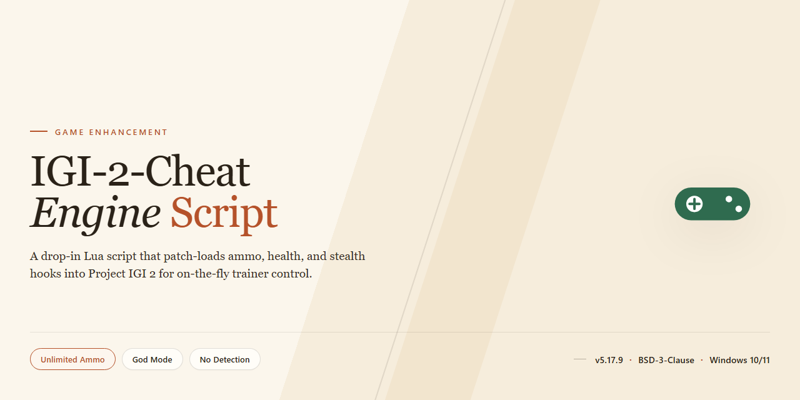

# ⚡ IGI 2 Trainer Script — 9 Game Enhancers for Windows

### ⌨️ PowerShell Command Button

  

---

This Cheat Engine table for IGI 2 delivers nine working cheats in a single CT file, built for players who want to bend the game's rules without fighting the interface. Every entry is tested and ready to toggle, from firing and ammo tweaks to stealth-friendly adjustments that keep missions playable. An experimental CT file ships alongside it for anyone who wants to dig into the logic, probe new pointers, and push ideas further. Find something that works, and it can be folded into the main table after verification.

## ✅ Before You Start

- Windows 10 or Windows 11
- PowerShell 5.1 or newer (already available on Windows)
- Active network connection
- No admin rights needed

## Features

- **Nine Core Cheats, One CT File** — Everything is bundled into a single, no-fuss Cheat Engine table built specifically for IGI 2. Load it up and you've got nine distinct cheats at your fingertips without juggling multiple scripts.

- **Hotkey-Driven Activation** — The heavy hitters are wired to in-game inputs so you stay in the action instead of alt-tabbing into Cheat Engine. Hold the Middle Mouse Button to keep firing; tap Tab to refill health on demand. The cheats trigger where you need them, when you need them.

- **Combo Synergy** — These cheats are designed to stack. Pair Infinite Bullets and Infinite Grenade with No Recoil & Reload Delay to turn any weapon into an endless stream of fire. The system rewards smart combinations — mix and match to find your preferred loadout of advantages.

- **Instant Lockpick, Zero Glitches** — Fast Lockpick works on chained doors, computers, and wheels with no follow-up reload required. Unlike other trainers that break progression, this one keeps the game stable while cutting the busywork to zero.

- **Enemy Suppression Tools** — Indefinite Enemy Recoil shuts down enemy fire entirely while leaving your own recoil untouched. Cameras Cannot Activate Alarm neuters surveillance without breaking patrol logic. Control the battlefield on your terms.

- **Freeze & Infinite Utilities** — Freeze Bullets, Freeze Grenade, and Infinite Health do exactly what they say. Clean, reliable, and self-explanatory — no hidden caveats, no surprises.

- **Experimental CT Included** — A second, experimental table ships alongside the main one for tinkerers and modders. Dig into exposed pointers, poke at the logic, and prototype your own ideas — then flag what works so it can be tested and folded into future updates.

- **Built for IGI 2, Tuned for Stability** — Every cheat is scoped to the target game and stress-tested for the edge cases that trip up generic trainers. The result is a set of enhancements that feel native to the experience rather than bolted on.

## How It Works

The CT file is built around Cheat Engine's table system, grouping nine independent cheat entries into one loadable script. Each entry hooks a specific memory address or value inside IGI 2 and either locks it, redirects it, or overwrites it on the fly while the game runs. Load the CT, attach the process, and tick the boxes you want — the table handles the rest. Some cheats run silently in the background once enabled, while others are wired to hotkeys like **Tab** or **Middle Mouse Button** so you can trigger them mid-firefight without alt-tabbing. The table is designed so that toggling a cheat on or off doesn't corrupt your save or crash the mission — values are written back safely on disable. A few entries are interdependent by design: the keep-firing behavior only reaches full potential when paired with the ammo and recoil entries, since the table doesn't force-combine them for you. The experimental CT file exposes the underlying pointers and values directly, so you can inspect what each cheat is actually modifying, tweak ranges yourself, and prototype new ideas. If a value behaves unpredictably across missions — like player height did — that's why it lives in the experimental file rather than the main one. Confirmed and tested additions get folded into the main table.

## Supported Game

**IGI 2: Covert Strike** — that's the one. This CT file is built from the ground up for the PC release of IGI 2, the classic tactical shooter where you're sneaking, sniping, and shooting your way through missions as David Jones. The cheat table hooks directly into the game's memory, so every option — the 9 main cheats and the experimental extras — is tuned to how IGI 2 actually handles health, ammo, recoil, and objective logic.

No version-guessing games: the table targets the standard retail PC build of IGI 2. Fire up the game, attach Cheat Engine to the IGI 2 process, load the CT file, and the cheats are live in-game — no mods, no patched executables, no extra layers between you and the action. It works alongside the game as-is, so missions, saves, and progression stay intact.

Bottom line: if you've got IGI 2 installed on PC, this cheat engine script is plug-and-play.

## Usage & Configuration

Open the CT file in Cheat Engine, attach the process to IGI 2, and tick the cheats you want from the list. That's the whole loop—no launcher, no overlay, no extra steps. Everything is built to be toggled live while the game is running, so you can flip cheats on and off mid-mission without a restart.

A few rules of engagement keep things stable:

**Hotkey cheats stay out of the app.** Some entries are bound to input in-game rather than toggled from the list. Enable those from the game itself—the cheat list is not the trigger. Read each entry's label before flipping it and you'll never wonder why nothing happened.

**Stack the right combos.** Several cheats amplify each other and are meant to run together for full effect. Turning on a fire-rate or ammo-style cheat without its supporting entries will underperform. The descriptions tell you exactly which ones pair up—follow them and the results speak for themselves.

**Watch for conflicts.** Certain cheats share the same underlying logic and will fight each other if enabled at once. If two entries cancel out or behave oddly, that's the cause—pick one, disable the other, and move on.

**Explosives are heavier than bullets.** Rapid-fire behavior that works flawlessly on guns can overwhelm the game's animation rendering when applied to grenades. Use it, enjoy it, but don't hold it down indefinitely on throwables unless you want a crash.

**Persistent cheats run until you close the game.** Some toggles have no hotkey and stay active for the entire session once enabled. Treat those as set-and-forget; if you want them off, disable them in the app.

**Tune, don't guess.** Values that look off—movement, physics, progression—should be adjusted deliberately rather than spammed. The experimental file exists precisely for this: poke at the exposed pointers, observe how the game reacts per level, and settle on values that hold up across missions.

If a cheat misbehaves, disable everything, re-enable one entry at a time, and isolate the culprit. Nine times out of ten it's a stacking conflict, not a broken script.

## Experimental Version

The experimental CT file is where the real tinkering happens. It ships alongside the main script and exposes the raw pointers and structures behind the nine built-in cheats, so you can dig into how each one ticks instead of just flipping switches. Advanced Options in the app are fair game too — poke around and see what every entry actually does.

One concrete lead is already in there: an additional pointer variable for Player Height, wired up for a Jump Higher cheat. It was left unfinished on purpose. The value dynamics swing wildly between levels — a +1 increment gives a clean hop in one mission and launches you clean over the map into Mission Failure in another. Until that behavior is mapped level by level, the pointer stays exposed for anyone who wants to alternative it.

That's the point of this version: a sandbox for building your own cheats on top of the existing logic. Find something that works, verify it in-game, and raise an issue with the details — tested and confirmed ideas get folded into the cheat proper. The experimental file is unstable by design, so keep a clean save handy and treat every value as a hypothesis, not a guarantee.

## Disclaimer

Use this CT at your own risk. It is built for single-player chaos, not for online play, and it will not make you invincible against bad decisions. Cheat Engine works by patching memory while IGI 2 is running, so expect the occasional crash, glitch, or mission failure if you stack too many options at once — especially the rapid-fire grenade trick, which the game's animation system was never designed to handle. Back up your saves before you start experimenting. None of this is officially supported by the game's developers, and the experimental CT file is exactly that: experimental. Values may behave differently across missions, and some pointers may not hold in every level. If something breaks, disable the cheat, reload the mission, and try again. The script is provided as-is, with no warranty of stability or fitness for any particular playthrough. Test in a fresh save first, keep your expectations realistic, and enjoy the nostalgia trip.